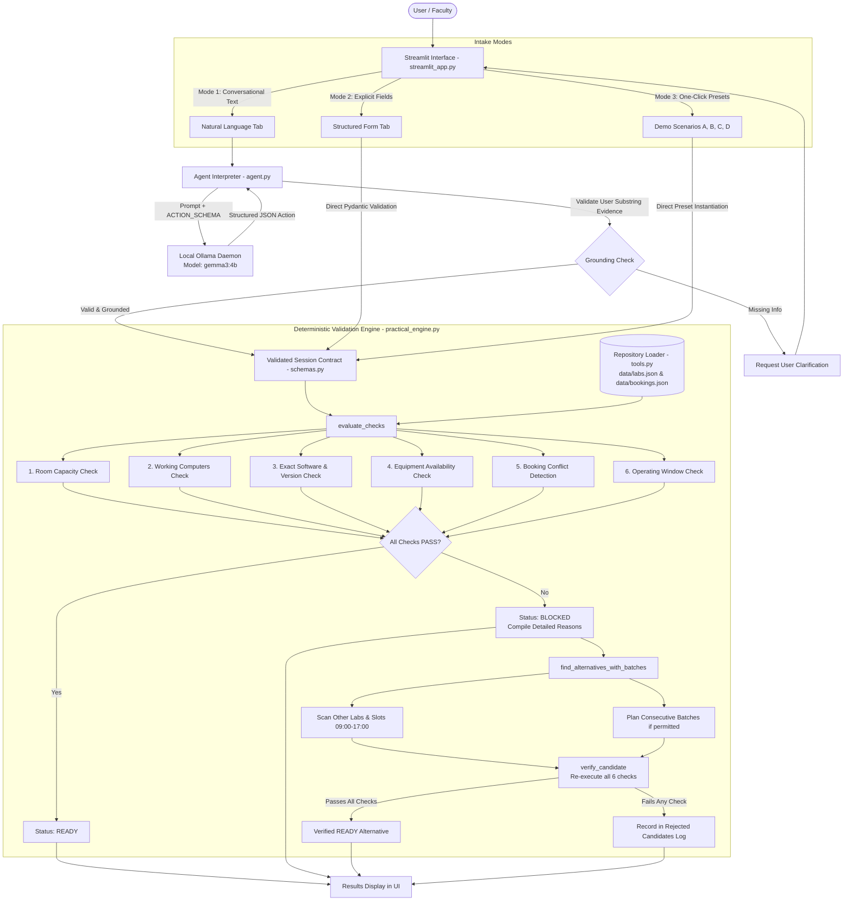
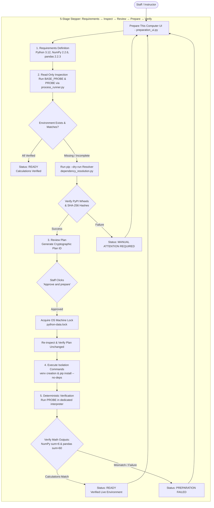

# LabReady — College Lab Readiness Agent

> **Know what will work before you book.**
>
> *"LabReady doesn't just identify why a practical cannot run. It finds an alternative and verifies that the alternative satisfies the practical's requirements."*

---

## Table of Contents

1. [Project Title and Introduction](#1-project-title-and-introduction)
2. [Project Overview](#2-project-overview)
   - [A. College Laboratory Readiness](#a-college-laboratory-readiness)
   - [B. Local Workstation Preparation](#b-local-workstation-preparation)
3. [The Problem Statement](#3-the-problem-statement)
4. [Project Goals and Design Principles](#4-project-goals-and-design-principles)
5. [Key Features](#5-key-features)
6. [Complete Project Directory Structure](#6-complete-project-directory-structure)
7. [System Architecture](#7-system-architecture)
   - [College Readiness Engine Architecture](#college-readiness-engine-architecture)
   - [Local Workstation Preparation Architecture](#local-workstation-preparation-architecture)
8. [How LabReady Works — Step by Step](#8-how-labready-works--step-by-step)
9. [Readiness Validation Rules](#9-readiness-validation-rules)
10. [AI Integration and Model Architecture](#10-ai-integration-and-model-architecture)
    - [AI Provider and Model Configuration](#ai-provider-and-model-configuration)
    - [Strict Schema Enforcement & Grounding Validation](#strict-schema-enforcement--grounding-validation)
    - [AI vs Deterministic Logic Matrix](#ai-vs-deterministic-logic-matrix)
11. [Data Model and Demonstration Data](#11-data-model-and-demonstration-data)
12. [Workstation Preparation Workflow](#12-workstation-preparation-workflow)
13. [Installation and Setup](#13-installation-and-setup)
14. [Configuration Reference](#14-configuration-reference)
15. [Running the Application](#15-running-the-application)
16. [Demonstration Scenarios](#16-demonstration-scenarios)
    - [Demo A: Practical Ready](#demo-a-practical-ready)
    - [Demo B: Practical Blocked with Verified Alternative](#demo-b-practical-blocked-with-verified-alternative)
    - [Demo C: No Feasible Alternative](#demo-c-no-feasible-alternative)
    - [Demo D: Student-Batch Splitting](#demo-d-student-batch-splitting)
17. [Testing and Quality Assurance](#17-testing-and-quality-assurance)
18. [Troubleshooting Guide](#18-troubleshooting-guide)
19. [Security, Privacy, and Safety](#19-security-privacy-and-safety)
20. [Limitations](#20-limitations)
21. [Deployment Guide](#21-deployment-guide)
22. [Technology Stack](#22-technology-stack)
23. [Future Roadmap](#23-future-roadmap)
24. [Contributing](#24-contributing)
25. [License](#25-license)
26. [Acknowledgments and Project Information](#26-acknowledgments-and-project-information)

---

## 1. Project Title and Introduction

### LabReady — College Lab Readiness Agent

In university computer science, data science, and engineering departments, academic practical sessions require precise alignment of physical rooms, working computer terminals, specific compiler/runtime versions, specialized hardware, and institutional timetable schedules.

When any of these variables fall out of alignment—such as an unrecorded timetable booking conflict, a class that exceeds the room's working computer count, or an outdated Python installation—the practical fails at runtime. Faculty, lab assistants, and department coordinators are forced into last-minute room swaps, impromptu cancellations, or scrambled manual rescheduling.

**LabReady** addresses this operational challenge by providing an automated, auditable decision assistant. It evaluates proposed practical sessions against institutional facility records, diagnoses exact blockers, automatically plans student cohort batch splits when permitted, and deterministically discovers and re-verifies alternative rooms and time windows before recommending them. For local machine preparation, LabReady includes a separate, approval-gated workstation preparation workflow that configures an isolated Python environment and mathematically verifies package functionality.

### Core Value Proposition

> **"LabReady doesn't just identify why a practical cannot run. It finds an alternative and verifies that the alternative satisfies the practical's requirements."**

### How AI Parsing and Deterministic Validation Work Together

LabReady strictly bifurcates language understanding from decision authority:
- **AI-Assisted Language Understanding**: A local Large Language Model (`gemma3:4b` running via Ollama) interprets conversational, natural-language practical requests and extracts structured requirements against strict Pydantic schemas. The model is also subject to regex grounding validation to ensure it never hallucinates dates, times, student counts, or software versions.
- **Deterministic Validation Engine**: 100% of readiness decisions, capacity evaluations, conflict checks, alternative slot searches, and batch divisions are executed by deterministic Python logic against structured facility data. The language model possesses **zero decision-making authority** over laboratory availability.

---

## 2. Project Overview

LabReady provides two distinct workflows within a unified Streamlit interface:

```
┌──────────────────────────────────────────────────────────────────────────────────┐
│                            LABREADY APPLICATION MODES                            │
├────────────────────────────────────────┬─────────────────────────────────────────┤
│    A. COLLEGE LABORATORY READINESS     │    B. LOCAL WORKSTATION PREPARATION     │
│       (Primary Decision Engine)        │        (Secondary Local Workflow)       │
├────────────────────────────────────────┼─────────────────────────────────────────┤
│ • Natural Language & Structured Intake │ • 5-Stage Stepper Workflow              │
│ • 6-Category Deterministic Checks      │ • Read-Only System Inspection           │
│ • Blocker Diagnosis & Audit Trail      │ • PyPI Dry-Run Dependency Resolution    │
│ • Student Batch Planning (Consecutive) │ • Explicit Human Approval Gate          │
│ • Alternative Slot Re-Verification     │ • Isolated Virtual Environment Creation │
│ • Fictional Demonstration Data         │ • NumPy & pandas Mathematical Probes    │
└────────────────────────────────────────┴─────────────────────────────────────────┘
```

### A. College Laboratory Readiness

The primary workflow assists faculty and department administrators in scheduling computer practicals:
1. **Intake**: The user defines practical parameters (date, time window, student count, software and exact version, equipment, preferred room, and batch splitting permission) via conversational English or an explicit structured form.
2. **Extraction & Grounding**: In AI mode, the local Gemma model maps the request into a strict `Session` contract, verified against literal user text.
3. **Multi-Dimensional Evaluation**: The deterministic engine inspects laboratory capacity, operational workstations (one per student), exact software versions, hardware equipment, booking calendars, and facility operating windows.
4. **Outcome & Alternatives**: If all checks pass, the session is declared `READY`. If any check fails, the session is marked `BLOCKED`, specific shortfall reasons are displayed, and the engine searches for alternative rooms or conflict-free time slots.
5. **Independent Candidate Re-Verification**: Every proposed alternative is run through the full deterministic check engine. No alternative is displayed as viable unless it independently achieves a `READY` status.

### B. Local Workstation Preparation

The secondary workflow operates strictly on the local Windows PC where LabReady is running:
1. **Scope**: Inspects and prepares a dedicated, isolated project environment at `.labready/practicals/python-data`.
2. **Safety**: Does not alter the global Python installation or the application's own virtual environment. It does not control, manage, or remotely execute actions on external college laboratory computers.
3. **Execution**: Uses a non-installing pip resolver to verify published wheel distributions and SHA-256 hashes, generates a fixed installation plan, requires explicit human click-through approval, installs packages into the isolated directory, and executes deterministic mathematical calculation probes (NumPy array sum = 6, pandas student aggregation = 60).

---

## 3. The Problem Statement

College practical sessions operate under complex, interconnected operational constraints:

- **Laboratory Capacity Limitations**: Classes assigned to rooms where total physical seating is less than the enrolled student cohort.
- **Broken / Non-Operational Workstations**: Rooms that nominally have enough desks, but where hardware defects reduce the working computer count below the class size (`working_computers < students`).
- **Software Version Incompatibilities**: Curriculum coursework written for modern language runtimes (e.g., Python 3.12) failing on laboratory machines running older, incompatible versions (e.g., Python 3.10).
- **Missing Specialized Equipment**: Practicals requiring physical peripherals (projectors, interactive whiteboards, robotic arms) scheduled in standard computer rooms.
- **Overlapping Timetable Bookings**: Room reservation conflicts resulting from disparate department bookings or unrecorded room usage.
- **Operating Window Restrictions**: Sessions requested outside institutional facility hours (standard operational hours: 09:00–17:00).
- **Oversized Student Cohorts**: Classes that exceed the capacity of any single laboratory, requiring systematic division into balanced, consecutive batches.
- **Late Discovery of Blockers**: Identification of facility shortcomings on the morning of a practical, leaving no time for remediation.
- **Manual Rescheduling Fatigue**: Department staff spending hours manually checking room sheets, timetable software, and equipment lists to find an open slot.

---

## 4. Project Goals and Design Principles

1. **Deterministic Authority**: Language models can hallucinate, omit edge cases, or introduce subtle inconsistencies. In LabReady, all readiness classifications, availability checks, and alternative evaluations are performed by pure, deterministic Python code.
2. **Strict Schema Contracts**: All application inputs, inventory records, and results are governed by strict Pydantic models with `extra="forbid"`, custom regex validators, and ISO-standard time constraints.
3. **Literal Grounding Verification**: The AI agent requires literal regex evidence from user messages for mandatory parameters (date, start time, end time, student count, software name, version) before dispatching domain tools. If information is missing, it asks clarification questions rather than guessing default values.
4. **Exhaustive Blocker Transparency**: When a practical cannot run, the system outputs clear, itemized reasons (e.g., *"Working computers 42 < 60 required (one per student)"* or *"Booking booking-b-20261027-01 overlaps 10:00–12:00"*).
5. **Mandatory Candidate Re-Verification**: An alternative arrangement is never recommended based on heuristics alone. The engine re-executes all 6 validation categories against the candidate slot before declaring it ready.
6. **Rejection Auditability**: Alternative searches retain an audit log of rejected candidate arrangements, detailing exactly why other rooms or slots were disqualified.
7. **Human-in-the-Loop Workstation Safety**: Local system modifications cannot be executed autonomously by an AI agent. The preparation workflow requires explicit staff approval of a cryptographically hashed plan.
8. **Subprocess Isolation**: Subprocess calls use argument vectors with `shell=False`, custom environment stripping, and bounded process-tree timeout management.
9. **Offline and AI-Independent Operation**: The application functions 100% offline. The structured input form and all instant demo presets operate without an active Ollama daemon or network connection.
10. **Clear Separation of Demonstration Data**: All laboratory records and schedules provided in `data/labs.json` and `data/bookings.json` are explicitly marked as fictional demonstration fixtures.

---

## 5. Key Features

1. **Natural-Language Practical Requests**: Instructors can describe their session in natural English (e.g., *"Check a Python 3.12 practical for 60 students on 2026-10-27 from 10:00 to 12:00"*).
2. **Structured-Form Input**: A comprehensive form interface allowing direct, deterministic entry of subject name, date, times, student count, software, version, equipment, preferred lab, and batch splitting options.
3. **AI-Assisted Requirement Extraction**: Integrated with local Ollama (`gemma3:4b`) to parse unstructured text into typed Pydantic session objects without cloud dependencies.
4. **Pydantic Schema Validation**: Validates date formats (`YYYY-MM-DD`), times (`HH:MM`, 00:00–23:59 Asia/Kolkata), non-zero student counts, and chronological ordering (`start < end`).
5. **Requirement Grounding & Hallucination Prevention**: Validates that extracted values match literal substrings in the user's prompt history. Unspecified parameters trigger clarifying questions.
6. **Laboratory Room Capacity Checks**: Confirms total physical room seating meets or exceeds the student count (`capacity >= students`).
7. **Computer Availability Checks**: Enforces one working, operational workstation per student (`working_computers >= students`). Broken machines are subtracted from capacity.
8. **Software Requirement & Version Checks**: Checks required software name and exact semantic version against lab records. Flags mismatched versions (e.g., Python 3.10 vs 3.12).
9. **Equipment Availability Checks**: Verifies requested hardware peripherals (`projector`, `whiteboard`, `robotic_arm`) against laboratory inventory records.
10. **Booking Conflict Detection**: Analyzes time-interval intersections (`start < existing_end` and `existing_start < end`) on the requested date to detect overlaps.
11. **Facility Operational Window Validation**: Confirms that requested sessions fit within permitted operating hours (default: 09:00 to 17:00).
12. **Grounded Blocker Explanations**: Provides granular, quantified explanations for failed constraints with numerical shortfalls and conflicting booking identifiers.
13. **Alternative Laboratory Selection**: Automatically scans all alternative laboratories in inventory to identify rooms satisfying requirements during the requested time slot.
14. **Alternative Time-Slot Evaluation**: Automatically scans operational facility hours (09:00–17:00) in step increments to discover conflict-free slots in qualified laboratories.
15. **Student Cohort Batch Splitting**: Automatically divides large student cohorts exceeding single-room capacity into balanced, consecutive batches (e.g., 60 students split into two 30-student sessions in Lab D).
16. **Independent Alternative Re-Verification**: Every discovered alternative candidate is re-evaluated across all 6 verification dimensions before presentation.
17. **Status Presentation**: Visual status badges (`READY` in green, `BLOCKED` in red, `UNVERIFIED` in yellow) and detailed per-check breakdown accordions.
18. **Session Reset & State Management**: "New session" reset button cleans conversation history, pending tasks, and preparation controllers to start fresh.
19. **Local Workstation Inspection**: Non-destructive, read-only inspection of the local Windows environment (`.labready/practicals/python-data`) verifying Python 3.12, pip, and package integrity.
20. **Human-Approved Preparation Actions**: Generates a hashed execution plan requiring explicit staff click-through approval before creating environments or installing packages.
21. **Post-Installation Verification Probes**: Runs deterministic Python calculation probes verifying exact package imports and mathematical outputs (NumPy array sum = 6, pandas DataFrame sum = 60).
22. **Instant Demonstration Scenarios**: Four pre-configured scenario buttons (Demo A, Demo B, Demo C, Demo D) for immediate evaluation without typing.
23. **100% Offline / No-AI Capability**: The entire core engine, structured form, test suite, and demo scenarios execute completely offline without Ollama.

---

## 6. Complete Project Directory Structure

```text
workshop-agent/
├── streamlit_app.py              # Application entry point: Streamlit UI, tabs, demo presets, state handling
├── app.py                        # CLI entry point: Interactive terminal interface, --demo, and --request modes
├── config.py                     # Configuration loader: Ollama host (http://localhost:11434) and default model
├── check_setup.py                # Diagnostic tool: Verifies Python 3.12+, venv, dependencies, and Ollama connection
├── requirements.txt              # Production dependencies: ollama==0.6.3, pydantic==2.14.1, streamlit==1.66.1
├── LICENSE                       # MIT License (Copyright 2026 Pranay Khodade)
├── README.md                     # Comprehensive project documentation
├── .env.example                  # Environment variable configuration template
├── .gitignore                    # Git ignore specifications (venv, caches, local state, .labready)
├── SKILL.md                      # System instructions and action schemas provided to the local agent
├── agent.py                      # LLM interaction loop: Ollama client, schema inlining, grounding validator
├── practical_engine.py           # Core deterministic engine: Verification checks, alternative search, batch planning
├── tools.py                      # Domain interface: Repository loader, check_session_readiness, find_alternatives
├── schemas.py                    # Strict Pydantic contracts: Session, Lab, Booking, Evidence, Candidate, VerificationCheck
├── ui_state.py                   # Streamlit state management: Review wrapper, conversation history, error handling
├── render.py                     # CLI text formatting for readiness reports and alternative candidate output
├── process_runner.py             # Subprocess execution utility: Enforces shell=False and process-tree termination
├── dependency_resolution.py      # Read-only pip resolver: Dry-run package resolution and wheel hash validation
├── preparation.py                # Local workstation preparation service: Locking, inspection, plan creation, execution
├── preparation_agent.py          # Gemma interpreter for local machine preparation requests
├── preparation_ui.py             # Streamlit UI for local workstation preparation: 5-stage stepper and fallback form
├── data/                         # Fictional demonstration data
│   ├── labs.json                 # Laboratory inventory: Capacities, working computers, software, equipment
│   └── bookings.json             # Calendar records: Pre-existing timetable reservations
└── tests/                        # Automated quality assurance suite (71 unit tests + browser smoke tests)
    ├── test_college_engine.py    # Unit tests for practical_engine.py (checks, alternatives, batch splitting)
    ├── test_preparation.py       # Unit tests for preparation.py, locking, resolution, and security gates
    ├── test_labready.py          # Tests for schemas, repository loading, and CLI rendering
    ├── test_ui.py                # Streamlit AppTest simulation tests for UI flows and state management
    ├── test_new_capabilities.py  # Tests for batch splitting, rejection tracking, and verification checklists
    ├── integration_ollama.py     # Live integration tests for Ollama gemma3:4b (requires local daemon)
    ├── browser_smoke.py          # Playwright end-to-end browser smoke test for college readiness flows
    └── preparation_browser_smoke.py # Playwright browser smoke test for workstation preparation UI
```

### Module Responsibilities and Connections

- **`streamlit_app.py`**: The primary user interface. Integrates `ui_state.py`, `practical_engine.py`, and `preparation_ui.py`. Renders custom CSS badges, instant demo scenario buttons, the intake tabs, metrics, and expandable trace cards.
- **`practical_engine.py`**: The core computational logic. Contains `evaluate_checks()`, `evaluate()`, `verify_candidate()`, and `find_alternatives_with_batches()`. Depends solely on `schemas.py` and `tools.py`.
- **`agent.py`**: Handles conversational intake. Inlines Pydantic schemas into JSON schema representations for `ollama.Client.chat()`, enforces zero-temperature generation, runs regex grounding checks, and invokes `tools.py`.
- **`schemas.py`**: Defines all typed contracts. Ensures strict validation on time inputs, ISO dates, integer ranges, and forbids extra fields.
- **`preparation.py`**: Implements the workstation preparation service. Manages OS file locks (`msvcrt` on Windows, `fcntl` on POSIX), inspects `.labready/practicals/python-data`, executes pip installations via `process_runner.py`, and runs calculation probes.
- **`dependency_resolution.py`**: Invokes `pip install --dry-run --report -` against PyPI to resolve dependencies without modifying the local system, validating package names against an allowlist and checking SHA-256 wheel hashes.
- **`process_runner.py`**: Central subprocess utility. Strictly mandates `shell=False`, captures standard output and error, and terminates entire spawned process trees using Windows `taskkill /PID <pid> /T /F` on timeout.
- **`tools.py`**: Loads JSON datasets (`data/labs.json`, `data/bookings.json`) into validated Pydantic instances, verifying foreign key references (e.g., every booking references an existing lab ID).

---

## 7. System Architecture

### College Readiness Engine Architecture



### Local Workstation Preparation Architecture



---

## 8. How LabReady Works — Step by Step

### Step 1: User Input
The user specifies the details of a practical session:
- **Practical Name**: Descriptive title (e.g., *"Data Science Practical"*).
- **Date**: Target calendar day formatted as `YYYY-MM-DD` (e.g., `2026-10-27`).
- **Time Slot**: Start and end times in 24-hour format `HH:MM` in Asia/Kolkata timezone (e.g., `10:00` to `12:00`).
- **Student Count**: Number of enrolled students needing workstations (e.g., `60`).
- **Software**: Required software names and exact versions (e.g., `Python 3.12`).
- **Equipment**: Required physical room hardware (e.g., `["projector", "whiteboard"]`).
- **Preferred Lab**: (Optional) Specific laboratory to evaluate (e.g., `lab-b`), or `"Any lab"`.
- **Batch Splitting**: (Optional) Boolean flag permitting division into smaller batches if room capacity is exceeded, along with maximum batches (e.g., `2`).

### Step 2: Input Interpretation
- **Natural Language Tab**: Passes prompt text to `Agent.run()` (`agent.py`).
- **Structured Form Tab**: Instantiates a typed `Session` object (`schemas.py`) directly from Streamlit widget values, bypassing LLM processing.
- **Demo Presets**: Instantiates pre-configured `Session` models immediately.

### Step 3: AI-Assisted Parsing
When using natural language:
- `Agent` connects to the local Ollama daemon (`http://localhost:11434`) using `ollama.Client`.
- Sends the conversation history along with `ACTION_SCHEMA` (inlined JSON schema representation of `Action`).
- The model (`gemma3:4b`) returns a structured JSON payload selecting either `check_session_readiness`, `find_alternatives`, `clarify`, or `done`.
- If Ollama is offline or the model is missing, the agent catches the exception and returns clear recovery guidance.

### Step 4: Requirement Validation & Grounding
- `Agent.validate_arguments()` verifies the model's arguments against `Session`.
- `Agent.validate_grounding()` scans the user's prompt history using regular expressions for each mandatory field (date, start time, end time, student count, software names, and versions).
- If the model attempts to invent values not supplied by the user, a `ValueError` is raised, prompting the model to request user clarification.

### Step 5: Laboratory Data Retrieval
- `Repository.load()` (`tools.py`) reads `data/labs.json` and `data/bookings.json`.
- Deserializes and validates all records into `Lab` and `Booking` Pydantic models.
- Verifies integrity constraints: unique lab IDs, unique booking IDs, and valid foreign key references from bookings to labs.

### Step 6: Deterministic Constraint Evaluation
`evaluate_checks()` in `practical_engine.py` evaluates 6 distinct categories for each laboratory:
1. **Room Capacity**: Confirms `lab.capacity >= session.students`.
2. **Working Computers**: Confirms `lab.working_computers >= session.students` (enforces 1 machine per student).
3. **Software & Versions**: Confirms installed software matches required names and exact semantic versions. Checks whether software is flagged as `unverified_software` in lab records.
4. **Equipment**: Confirms required peripherals exist in `lab.equipment` and are not marked `unverified_equipment`.
5. **Booking Conflicts**: Checks whether existing reservations overlap the requested interval on the requested date:
   $$\text{conflict} \iff (\text{start} < \text{booking.end}) \land (\text{booking.start} < \text{end})$$
6. **Operating Window**: Confirms the session falls between `allowed_window_start` (09:00) and `allowed_window_end` (17:00).

### Step 7: Readiness Determination
`evaluate()` compiles the check results into an overall status:
- If **any** check evaluates to `FAIL` $\rightarrow$ Status is **`BLOCKED`**.
- Else if **any** check evaluates to `UNKNOWN` $\rightarrow$ Status is **`UNVERIFIED`** (requires physical audit).
- Else all checks evaluate to `PASS` $\rightarrow$ Status is **`READY`**.

### Step 8: Blocker Explanation
For any lab evaluated as `BLOCKED`, `evaluate_checks()` compiles quantified explanations:
- Room capacity shortfall count (`students - capacity`).
- Working computer shortfall count (`students - working_computers`).
- Mismatched software versions (e.g., *"Requires Python 3.12; installed versions: 3.10"*).
- Missing equipment names.
- Conflicting booking IDs and their exact time intervals.

### Step 9: Alternative Generation
If the requested laboratory or slot is `BLOCKED`, `find_alternatives_with_batches()` executes an exhaustive search:
- Evaluates candidate start times from facility opening (09:00) to closing (17:00) minus duration.
- Evaluates all laboratories in the inventory.
- Skips the original requested slot (already reported).

### Step 10: Alternative Revalidation
Every discovered alternative candidate is passed to `verify_candidate()`.
- The engine executes a fresh, independent evaluation across all 6 categories.
- Only candidates that independently evaluate to `READY` are added to the recommendations list.
- Disqualified candidates are recorded in the `rejected` audit list with their disqualification reasons.

### Step 11: Batch Splitting
If `allow_batch_split=True` and single-session options are insufficient:
- The engine computes balanced batch sizes: $\text{batch\_size} = \lceil \text{students} / \text{num\_batches} \rceil$.
- Scans for consecutive or non-overlapping conflict-free slots within the operating window using simulated reservation tracking.
- Re-verifies all batches using `verify_candidate()`.

### Step 12: Results Presentation
Streamlit renders the results:
- Status banner indicating outcome (`Ready lab found`, `All checked labs blocked`, etc.).
- Requirement metric cards (Date, Time, Students).
- Laboratory cards with capacity, computer count, software, equipment, and booking details.
- Expandable **Verification Checklist** detailing individual check evidence and statuses.
- Validated alternative laboratory recommendations.
- Expandable **Audit trail: rejected candidate alternatives** detailing disqualified options.
- Expandable **How this was checked** log detailing observable protocol events.

---

## 9. Readiness Validation Rules

### Multi-Dimensional Verification Matrix

| Validation Dimension | Exact Condition Evaluated | PASS Condition | FAIL Condition | UNKNOWN Condition |
|---|---|---|---|---|
| **Room Capacity** | Physical desk seats in laboratory | `lab.capacity >= session.students` | `lab.capacity < session.students` | N/A (Record must define integer capacity) |
| **Working Computers** | Operational terminals (1 per student) | `lab.working_computers >= session.students` | `lab.working_computers < session.students` | N/A (Record must define integer count) |
| **Required Software** | Installed application runtime | Installed and verified in lab inventory | Software missing from laboratory | Listed in `unverified_software` inventory |
| **Software Version** | Exact semantic version match | `required.version == installed.version` | Version mismatch (e.g. 3.10 vs 3.12) | Software unverified in lab inventory |
| **Equipment** | Peripherals (`projector`, `whiteboard`, etc.) | Item present in `lab.equipment` | Item absent from `lab.equipment` | Item listed in `unverified_equipment` |
| **Schedule Bookings** | Overlapping timetable reservations | No bookings intersect requested interval | Existing booking overlaps requested interval | N/A (All bookings in record are definitive) |
| **Operating Window** | Facility operational hours (09:00–17:00) | `start >= 09:00` and `end <= 17:00` | Session begins before 09:00 or ends after 17:00 | N/A (Operational hours are fixed) |

### Status Aggregation Logic

Each category check produces a `VerificationCheck` object with a status of `PASS`, `FAIL`, `UNKNOWN`, or `NOT_APPLICABLE`. The overall lab readiness is computed as:

```python
if any(check.status == "FAIL" for check in checks):
    status = "BLOCKED"
elif any(check.status == "UNKNOWN" for check in checks):
    status = "UNVERIFIED"
else:
    status = "READY"
```

### Concrete Evaluation Examples

#### Scenario 1: Fully Satisfied Practical
- **Request**: 50 students, Python 3.12, projector, whiteboard. 2026-10-27 from 13:00 to 15:00.
- **Evaluation against Lab B** (Capacity: 65, Working PCs: 65, Python 3.12, projector, whiteboard, no bookings 13:00–15:00):
  - Room Capacity: 65 >= 50 $\rightarrow$ `PASS`
  - Working Computers: 65 >= 50 $\rightarrow$ `PASS`
  - Software: Python 3.12 verified $\rightarrow$ `PASS`
  - Equipment: Projector and whiteboard verified $\rightarrow$ `PASS`
  - Bookings: No overlap $\rightarrow$ `PASS`
  - Operating Window: 13:00–15:00 within 09:00–17:00 $\rightarrow$ `PASS`
- **Result**: **`READY`**

#### Scenario 2: Hardware Defect / Shortfall
- **Request**: 60 students, Python 3.12. 2026-10-27 from 10:00 to 12:00.
- **Evaluation against Lab A** (Capacity: 60, Working PCs: 42):
  - Room Capacity: 60 >= 60 $\rightarrow$ `PASS`
  - Working Computers: 42 < 60 $\rightarrow$ **`FAIL`** (*Shortfall of 18 operational workstations*)
- **Result**: **`BLOCKED`**

#### Scenario 3: Timetable Overlap Conflict
- **Request**: 60 students, Python 3.12. 2026-10-27 from 10:00 to 12:00.
- **Evaluation against Lab B** (Has pre-existing booking `booking-b-20261027-01` from 10:00 to 12:00):
  - Schedule Availability: Overlaps `booking-b-20261027-01` $\rightarrow$ **`FAIL`**
- **Result**: **`BLOCKED`**

#### Scenario 4: Software Version Mismatch
- **Request**: 60 students, Python 3.12. 2026-10-27 from 10:00 to 12:00.
- **Evaluation against Lab C** (Capacity: 60, Working PCs: 60, Installed: Python 3.10):
  - Software Readiness: Requires Python 3.12; installed 3.10 $\rightarrow$ **`FAIL`**
- **Result**: **`BLOCKED`**

---

## 10. AI Integration and Model Architecture

### AI Provider and Model Configuration

- **Runtime Engine**: Local [Ollama](https://ollama.ai) daemon running on `http://localhost:11434`.
- **Python Client**: `ollama==0.6.3` (official Python bindings).
- **Configured Model**: **Gemma 3 4B** (`gemma3:4b`).
  - *Note*: LabReady explicitly uses the 4-billion parameter Gemma 3 model. It does not use or claim integration with "Gemma 4" (which does not exist).
- **Default Parameters**:
  - `temperature`: `0` (enforces deterministic token generation)
  - `num_predict`: `1200`
  - `num_ctx`: `8192` (context window length)
  - `timeout`: `90.0` seconds (agent), `120.0` seconds (diagnostics)

### Strict Schema Enforcement & Grounding Validation

Small local language models can struggle with complex `$defs` references. LabReady implements `inline_schema()` (`agent.py`) to flatten JSON schemas directly into the format parameter sent to Ollama:

```python
ACTION_SCHEMA = inline_schema(Action)
# Enforces one of: CheckAction, AlternativeAction, ClarifyAction, DoneAction
```

After the model produces an action:
1. **Pydantic Validation**: `Action.model_validate_json(content, strict=True)`. Any extra properties or malformed types cause an immediate validation rejection.
2. **Grounding Validation**: `validate_grounding()` verifies that all extracted values exist as literal substrings in the user's prompt history:
   ```python
   re.search(r"(?<![\w.])" + re.escape(value.casefold()) + r"(?!\w|\.\d)", text)
   ```
   If the model infers or hallucinates an unstated date, time, count, or software version, the action is rejected, and the model is prompted to request clarification.
3. **Automatic Alternative Search Policy**: If a check evaluates to `BLOCKED` and the model halts without searching for alternatives, the application policy (`agent.ensure_alternatives()`) automatically invokes `find_alternatives` on behalf of the user.

### AI vs Deterministic Logic Matrix

| Functional Responsibility | AI Model (`gemma3:4b`) | Deterministic Logic (`practical_engine.py`) | Architectural Rationale |
|---|---|---|---|
| **Conversational Understanding** | **Yes** (Interprets phrasing) | No | LLMs excel at parsing flexible human language. |
| **Requirement Extraction** | **Yes** (Maps to schema) | No | Converts free text into structured `Session` arguments. |
| **Schema Validation** | No | **Yes** (Pydantic `strict=True`) | Enforces type safety, integer constraints, date formats. |
| **Grounding Verification** | No | **Yes** (Regex check) | Prevents hallucinations and unstated assumptions. |
| **Capacity Evaluation** | No | **Yes** (`capacity >= students`) | Mathematical comparison against verified records. |
| **Computer Count Verification** | No | **Yes** (`working >= students`) | Mathematical comparison against verified records. |
| **Software & Version Matching** | No | **Yes** (String version match) | Case-insensitive name match, exact version check. |
| **Booking Conflict Detection** | No | **Yes** (Interval overlap math) | Accurate timetable intersection without edge-case misses. |
| **Operating Window Check** | No | **Yes** (Minute conversion) | Ensures session fits within 09:00–17:00. |
| **Alternative Search & Batching** | No | **Yes** (Iterative search) | Exhaustive combinatorial slot and batch exploration. |
| **Alternative Re-Verification** | No | **Yes** (Fresh re-evaluation) | Guarantees candidates are genuinely viable. |
| **Final Readiness Decision** | No | **Yes** (Pure Python status) | Zero AI authority over laboratory feasibility. |

---

## 11. Data Model and Demonstration Data

All institutional laboratory and timetable records are stored in local JSON files in the `data/` directory.

### `data/labs.json` Record Schema

```json
{
  "notice": "FICTIONAL DEMONSTRATION DATA. Not verified college availability.",
  "labs": [
    {
      "id": "lab-a",
      "name": "Lab A",
      "capacity": 60,
      "total_computers": 60,
      "working_computers": 42,
      "software": [
        {"name": "Python", "version": "3.12"}
      ],
      "equipment": ["projector", "whiteboard"]
    },
    {
      "id": "lab-b",
      "name": "Lab B",
      "capacity": 65,
      "total_computers": 65,
      "working_computers": 65,
      "software": [
        {"name": "Python", "version": "3.12"}
      ],
      "equipment": ["projector", "whiteboard"]
    },
    {
      "id": "lab-c",
      "name": "Lab C",
      "capacity": 60,
      "total_computers": 60,
      "working_computers": 60,
      "software": [
        {"name": "Python", "version": "3.10"}
      ],
      "equipment": ["projector", "whiteboard"]
    },
    {
      "id": "lab-d",
      "name": "Lab D (Batch Capable)",
      "capacity": 35,
      "total_computers": 35,
      "working_computers": 35,
      "software": [
        {"name": "Python", "version": "3.12"}
      ],
      "equipment": ["projector", "whiteboard"]
    },
    {
      "id": "lab-e",
      "name": "Lab E (Robotics)",
      "capacity": 30,
      "total_computers": 30,
      "working_computers": 30,
      "software": [
        {"name": "ROS", "version": "2.0"}
      ],
      "equipment": ["projector", "robotic_arm"],
      "unverified_software": ["ROS"]
    }
  ]
}
```

### `data/bookings.json` Record Schema

```json
{
  "notice": "FICTIONAL DEMONSTRATION DATA. Recommendations do not reserve a lab.",
  "bookings": [
    {
      "id": "booking-b-20261027-01",
      "lab_id": "lab-b",
      "date": "2026-10-27",
      "start": "10:00",
      "end": "12:00"
    }
  ]
}
```

> [!IMPORTANT]
> **Notice on Demonstration Data**: The laboratory facilities, capacities, working workstation counts, installed software, and booking records provided in this repository are **fictional demonstration records** designed for demonstration and automated testing. LabReady does not currently interface with a live college scheduling ERP or campus database.

---

## 12. Workstation Preparation Workflow

The workstation preparation workflow (`preparation.py`, `preparation_ui.py`) is an independent, approval-gated tool for preparing the **local Windows computer** for practical execution:

```
[1. Requirements] ──> [2. Inspect] ──> [3. Review Plan] ──> [4. Prepare] ──> [5. Verify]
```

### 1. Requirements Definition
The user specifies the required Python version (fixed to `3.12`) and approved packages (`numpy==2.2.6` and `pandas==2.2.3`). Users can type in natural language (interpreted by `PreparationInterpreter` in `preparation_agent.py`) or use the validated input box.

### 2. Read-Only System Inspection
`PreparationService.inspect()` executes non-destructive inspection probes:
- Confirms the managed environment path resolves strictly to `.labready/practicals/python-data`.
- Rejects symlinks, junctions, or directory traversals.
- Checks if the environment exists. If missing, captures creator metadata using `BASE_PROBE`.
- If the environment exists, runs `PROBE` using the dedicated interpreter to inspect installed versions.

### 3. Dependency Resolution & Plan Generation
If the environment is not prepared:
- `dependency_resolution.resolve()` runs `pip install --dry-run --report -` against PyPI.
- Validates that returned wheel packages match the allowlist (`numpy`, `pandas`, `python-dateutil`, `pytz`, `tzdata`, `six`), originate from `files.pythonhosted.org`, and contain valid SHA-256 hashes.
- `make_plan()` generates a cryptographic SHA-256 plan hash (`plan.id`) representing the exact commands to run.

### 4. Human Approval Gate
- System commands **cannot** run automatically.
- The UI displays the proposed actions and exact shell commands.
- The user must click **"Approve and prepare"**.
- `approve()` generates a single-use URL-safe token bound to that specific `plan.id`. Any modification to the requirements invalidates the plan.

### 5. Isolated Execution
- `PreparationService.execute()` acquires an OS machine lock (`.labready/runtime/python-data.lock`).
- Re-verifies that the plan has not changed.
- Creates the dedicated virtual environment using `python -m venv --copies .labready/practicals/python-data`.
- Installs the resolved wheel packages using `--isolated --require-virtualenv --no-cache-dir --only-binary=:all: --no-deps`.

### 6. Mathematical Verification Probes
Before declaring the environment `READY`, LabReady runs a deterministic verification probe inside the newly prepared environment:
- Computes `numpy.array([1, 2, 3]).sum()`, verifying the result equals `6`.
- Computes `pandas.DataFrame({'students': [20, 20, 20]})['students'].sum()`, verifying the result equals `60`.
- The environment is marked `READY` **only if both mathematical assertions pass**.

---

## 13. Installation and Setup

### System Prerequisites
- **Operating System**: Windows 10 / 11 (x64) (Tested on Windows PowerShell)
- **Python Runtime**: Python 3.12 or later installed and added to your `PATH`
- **Git**: Installed for cloning the repository
- **Local AI Daemon (Optional)**: [Ollama](https://ollama.ai) installed and running locally with the `gemma3:4b` model pulled

> [!NOTE]
> Ollama is required **only** for natural-language interpretation. The deterministic structured form, instant demo scenarios, core engine, and workstation preparation workflow function 100% offline without Ollama.

### Step-by-Step PowerShell Setup

```powershell
# 1. Clone the repository
git clone https://github.com/pranaykhodade1922-dot/Hacktoberfest.git
cd Hacktoberfest

# 2. Create a dedicated virtual environment
python -m venv venv

# 3. Activate the virtual environment
.\venv\Scripts\Activate.ps1

# If PowerShell script execution is restricted on your machine, run:
# Set-ExecutionPolicy -Scope Process -ExecutionPolicy Bypass

# 4. Upgrade pip and install pinned dependencies
python -m pip install --upgrade pip
pip install -r requirements.txt

# 5. Optional: Set up Ollama for natural language mode
# In a separate terminal or service, ensure Ollama is running:
ollama pull gemma3:4b

# 6. Run the diagnostic setup checker
python check_setup.py

# 7. Launch the Streamlit web application
python -m streamlit run streamlit_app.py --server.address=127.0.0.1 --server.port=8501
```

Once launched, open your browser and navigate to:
```
http://127.0.0.1:8501
```

---

## 14. Configuration Reference

LabReady relies on local environment variables with sensible defaults. No third-party API keys or paid cloud credentials are used.

| Variable Name | Default Value | Required? | Example Value | Where Read | Description |
|---|---|---|---|---|---|
| `OLLAMA_MODEL` | `gemma3:4b` | No | `gemma3:4b` | `config.py` (`get_model`) | Defines the local Ollama model identifier used for natural-language requirement parsing. |

A template file [`.env.example`](file:///.env.example) is included in the repository root:

```text
# LabReady Configuration Options
# Local Ollama model selection (default: gemma3:4b)
# Used exclusively for natural-language practical requirement interpretation.
# Not required for deterministic structured-form evaluation or instant demo scenarios.
OLLAMA_MODEL=gemma3:4b
```

---

## 15. Running the Application

### User Interface Layout

```
┌──────────────────────────────────────────────────────────────────────────────────┐
│ LABREADY · COLLEGE LAB READINESS & VERIFIED ALTERNATIVES        [New session]   │
│ Prepare your lab. Verify it works.                                               │
├──────────────────────────────────────────────────────────────────────────────────┤
│ Stepper: 1. Define Practical → 2. Check Readiness → 3. Blockers → 4. Alts ...   │
├──────────────────────────────────────────────────────────────────────────────────┤
│ Instant Demo Scenarios:                                                          │
│ [Demo A: Practical Ready] [Demo B: Blocked + Alt] [Demo C: No Alt] [Demo D: Batch]│
├────────────────────────────────────────┬─────────────────────────────────────────┤
│ DEFINE YOUR PRACTICAL (Left Column)    │ READINESS RESULTS (Right Column)        │
│                                        │                                         │
│ Tab 1: Natural Language (AI-Assisted)  │ • Status Banner                         │
│   • Text area for practical request    │ • Practical Requirement Metric Cards    │
│   • [Load example] [Check readiness]   │ • Laboratory Readiness Cards            │
│   • Collapsible Conversation log       │ • Verification Checklists (Expandable)  │
│                                        │ • Validated Alternative Cards           │
│ Tab 2: Structured Form (Deterministic) │ • Rejected Candidates Audit Trail       │
│   • Name, Date, Students, Times        │ • Execution Trace Log (Expandable)      │
│   • Software, Version, Equipment       │                                         │
│   • Batch Planning & Window Options    │                                         │
│   • [Check readiness (Deterministic)]  │                                         │
├────────────────────────────────────────┴─────────────────────────────────────────┤
│ PREPARE THIS COMPUTER (Secondary Local Workflow)                                 │
│ Stepper: 1. Requirements → 2. Inspect → 3. Review plan → 4. Prepare → 5. Verify │
│ • Natural Language Input & [Load practical example]                              │
│ • Validated Local Python Version & Allowlisted Packages                          │
│ • [Inspect and propose preparation] Button                                       │
│ • Live Inspection Findings Card                                                  │
│ • Proposed Actions & Fixed Commands Expander                                     │
│ • Primary [Approve and prepare] Button with Progress Bar                         │
│ • Calculation Probes Verification Result                                         │
│ • Fictional Fallback Search Form                                                 │
└──────────────────────────────────────────────────────────────────────────────────┘
```

### Key UI Interactions

- **New Session**: Clears current conversation history, pending tasks, and cached preparation states, returning the interface to its clean initial state.
- **Natural Language Tab**: Allows conversational input. Clicking **Load example** inserts:
  `Check a Python 3.12 practical for 60 students on 2026-10-27 from 10:00 to 12:00.`
- **Structured Form Tab**: Allows full specification without AI. Immediately evaluates all constraints upon clicking **Check readiness (Deterministic)**.
- **Verification Checklist**: Clicking the checklist summary on any lab card expands the complete breakdown showing the individual status (`PASS`, `FAIL`, `UNKNOWN`) and evidence for all 6 check categories.
- **Rejected Candidates Audit Trail**: When alternatives are searched, expanding this panel reveals every disqualified room and time slot along with the exact reasons for rejection.
- **Local Workstation Stepper**: Visualizes the 5-stage preparation lifecycle on the local computer.

---

## 16. Demonstration Scenarios

Four instant scenarios are built into the UI toolbar for rapid evaluation:

### Demo A: Practical Ready

- **Purpose**: Demonstrates a practical session where all resource, capacity, and scheduling constraints are satisfied.
- **Input Parameters**:
  - Practical Name: *"Data Structures Lab"*
  - Date: `2026-10-27`
  - Time Slot: `13:00` to `15:00` (Asia/Kolkata)
  - Student Count: `50`
  - Software: `Python 3.12`
  - Equipment: `projector`, `whiteboard`
  - Preferred Lab: None (`Any lab`)
- **Expected Behavior**: Evaluates inventory across all labs. Identifies Lab B as a qualifying facility.
- **Validation**: All 6 verification categories evaluate to `PASS` in Lab B (Capacity: 65 $\ge$ 50, Working PCs: 65 $\ge$ 50, Python 3.12 verified, projector/whiteboard present, no booking conflicts).
- **Expected Outcome**: Overall status **`READY`**. Lab B displayed with green status badge. No alternative search needed.

---

### Demo B: Practical Blocked with Verified Alternative

- **Purpose**: Demonstrates diagnosis of a timetable booking conflict and automatic discovery and re-verification of a feasible alternative time slot.
- **Input Parameters**:
  - Practical Name: *"Data Science Practical"*
  - Date: `2026-10-27`
  - Time Slot: `10:00` to `12:00` (Asia/Kolkata)
  - Student Count: `60`
  - Software: `Python 3.12`
  - Equipment: `projector`, `whiteboard`
  - Preferred Lab: None (`Any lab`)
- **Expected Behavior**: Evaluates the requested slot, identifies that all labs are blocked, diagnoses the specific blockers, searches facility hours, and recommends an alternative.
- **Validation**:
  - Lab A: `BLOCKED` (Working computers 42 < 60 required).
  - Lab B: `BLOCKED` (Conflicting booking `booking-b-20261027-01` overlaps 10:00–12:00).
  - Lab C: `BLOCKED` (Requires Python 3.12; installed 3.10).
  - Lab D: `BLOCKED` (Room capacity 35 < 60).
  - Lab E: `BLOCKED` (Capacity 30 < 60, missing software).
- **Verified Alternative**: LabReady identifies Lab B at **`12:00–14:00`**. The engine independently re-checks capacity, computers, software, equipment, and bookings, confirming all evaluate to `PASS`.
- **Expected Outcome**: Requested slot marked **`BLOCKED`**. Alternative slot in Lab B (12:00–14:00) displayed as **`READY`**.

---

### Demo C: No Feasible Alternative

- **Purpose**: Demonstrates handling an unfulfillable practical request where no facility in the institution can satisfy the constraints.
- **Input Parameters**:
  - Practical Name: *"Robotics & Autonomous Systems"*
  - Date: `2026-10-27`
  - Time Slot: `10:00` to `12:00` (Asia/Kolkata)
  - Student Count: `70`
  - Software: `ROS 2.0`
  - Equipment: `robotic_arm`
  - Preferred Lab: None (`Any lab`)
- **Expected Behavior**: Evaluates all laboratories and time slots. Identifies that the student count exceeds the largest lab capacity (65 seats) and that the robotic arm is unavailable elsewhere.
- **Validation**: All labs fail capacity or equipment constraints. Lab E has the robotic arm but only 30 seats and unverified ROS installation.
- **Expected Outcome**: Overall status **`BLOCKED`**. Displays message: *"No feasible alternative found."* Generates an audit trail of rejected candidates explaining why each room was rejected.

---

### Demo D: Student-Batch Splitting

- **Purpose**: Demonstrates automatic student cohort division into balanced, consecutive batches when a cohort exceeds single-room capacity.
- **Input Parameters**:
  - Practical Name: *"Machine Learning Workshop"*
  - Date: `2026-10-27`
  - Time Slot: `10:00` to `12:00` (Asia/Kolkata)
  - Student Count: `60`
  - Software: `Python 3.12`
  - Equipment: `projector`, `whiteboard`
  - Preferred Lab: `lab-d` (Capacity: 35 seats, Working PCs: 35)
  - Allow Batch Split: `True` (Max Batches: `2`)
- **Expected Behavior**: Identifies that 60 students cannot fit into Lab D simultaneously. Calculates balanced batches of 30 students each ($60 / 2 = 30 \le 35$). Searches for consecutive conflict-free windows in Lab D.
- **Validation**:
  - Single session in Lab D: `BLOCKED` (Capacity 35 < 60).
  - Batch 1 (30 students): Scheduled `10:00–12:00` in Lab D $\rightarrow$ Re-verified `READY`.
  - Batch 2 (30 students): Scheduled `12:00–14:00` in Lab D $\rightarrow$ Re-verified `READY`.
- **Expected Outcome**: Proposes a verified split schedule:
  - **Batch 1**: 30 students · 10:00–12:00 · Lab D (Batch Capable) (Verified)
  - **Batch 2**: 30 students · 12:00–14:00 · Lab D (Batch Capable) (Verified)

---

## 17. Testing and Quality Assurance

LabReady features an automated test suite comprising unit tests, integration contracts, AppTest UI simulations, and Playwright browser smoke tests.

### Running Unit & Integration Tests

All unit tests execute offline without requiring internet access or a running Ollama server:

```powershell
# Run the complete test suite (71 automated tests)
venv\Scripts\python -m unittest discover tests

# Run specific functional test modules
venv\Scripts\python -m unittest tests/test_college_engine.py
venv\Scripts\python -m unittest tests/test_preparation.py
venv\Scripts\python -m unittest tests/test_labready.py
venv\Scripts\python -m unittest tests/test_ui.py
venv\Scripts\python -m unittest tests/test_new_capabilities.py
```

*Observed Test Suite Output:*
```text
Ran 71 tests in 4.923s
OK
```

### Running Browser Smoke Tests (Playwright)

To validate live UI rendering, state transitions, and browser interactions, start the Streamlit server on port 8501, then execute the smoke tests:

```powershell
# In Terminal 1: Launch Streamlit
venv\Scripts\python -m streamlit run streamlit_app.py --server.address=127.0.0.1 --server.port=8501 --server.headless=true

# In Terminal 2: Run Workstation Preparation UI Browser Smoke Test
venv\Scripts\python tests/preparation_browser_smoke.py --url http://127.0.0.1:8501

# In Terminal 2: Run College Readiness End-to-End Browser Smoke Test
venv\Scripts\python tests/browser_smoke.py
```

### Test Suite Structure

- **`test_college_engine.py`**: Validates `evaluate_checks()`, room capacity arithmetic, computer shortfalls, version matching, interval overlap mathematics, and candidate re-verification.
- **`test_preparation.py`**: Validates file system safety, path traversal prevention, symlink rejection, machine locking (`msvcrt`), pip dry-run resolution, plan hash generation, and mathematical calculation probes.
- **`test_labready.py`**: Validates Pydantic contracts, ISO time conversions, minutes arithmetic, and CLI text rendering.
- **`test_ui.py`**: Uses `streamlit.testing.v1.AppTest` to simulate tab switching, form submissions, and session state management.
- **`test_new_capabilities.py`**: Validates batch splitting arithmetic, simulation reservation tracking, and rejection audit logging.

---

## 18. Troubleshooting Guide

| Symptom / Error | Likely Cause | Diagnostic Command | Recommended Resolution | Verification |
|---|---|---|---|---|
| `ERROR: This workshop requires Python 3.12 or later.` | System default Python is older than 3.12. | `python --version` | Install Python 3.12 from python.org and recreate `venv`. | `venv\Scripts\python --version` outputs `Python 3.12.x`. |
| Script execution disabled in PowerShell. | Windows Execution Policy blocks unsigned scripts. | `Get-ExecutionPolicy` | Run `Set-ExecutionPolicy -Scope Process -ExecutionPolicy Bypass` in your session. | `.\venv\Scripts\Activate.ps1` runs without errors. |
| `Cannot connect to Ollama at http://localhost:11434` | The Ollama desktop app or daemon is not running. | `curl -I http://localhost:11434` | Start the Ollama application from the Start Menu or run `ollama serve`. | `curl http://localhost:11434` returns `Ollama is running`. |
| `The selected model gemma3:4b is missing.` | Model has not been downloaded to local Ollama cache. | `ollama list` | Run `ollama pull gemma3:4b`. | `ollama list` displays `gemma3:4b` in the list. |
| `Port 8501 is already in use.` | A previous Streamlit process is still running. | `netstat -ano \| findstr 8501` | Terminate the process holding port 8501: `taskkill /PID <PID> /F`. | `curl -I http://127.0.0.1:8501` returns connection refused before restart. |
| `Clarification required: explicitly provide...` | Prompt did not contain literal text for mandatory fields. | Check user prompt in Conversation expander. | Provide the missing field explicitly (e.g. state date as `2026-10-27` or count as `60 students`). | Agent advances to tool execution without clarification prompt. |
| `Another preparation holds the computer lock.` | Stale lock file or simultaneous preparation running. | Check `.labready/runtime/python-data.lock`. | Ensure no other browser tab is preparing. Wait for completion or restart the app. | Inspection completes and lock is acquired cleanly. |
| `StreamlitWidgetAlreadyInstantiatedError` | Widget session state modified after widget was rendered. | Check console traceback. | Use decoupled pending state keys (`_pending`) updated via button callbacks prior to render. | App reloads cleanly without widget errors. |
| Browser smoke test fails on heading assertion. | Streamlit page did not finish loading before Playwright checked. | Check Playwright screenshot or error log. | Ensure Streamlit server is running on `127.0.0.1:8501` and rerun test with `--url http://127.0.0.1:8501`. | Smoke test outputs `PASS` and exits with code 0. |

---

## 19. Security, Privacy, and Safety

- **Local Host Execution**: All data processing and AI model inference occur entirely on `localhost`. No student information, practical requests, or facility data are transmitted to external cloud APIs.
- **Subprocess Isolation**: Subprocess invocations in `process_runner.py` and `preparation.py` mandate `shell=False` and pass arguments as structured vectors. System command injection via string concatenation is architecturally prevented.
- **Process Tree Bounding**: Long-running or stalled subprocesses are monitored with strict timeouts (120–240 seconds). On timeout, Windows `taskkill /PID <pid> /T /F` terminates the entire spawned process tree without affecting unrelated system processes.
- **Filesystem Boundaries**: The preparation workflow strictly confines file creation to `.labready/practicals/python-data`. Any path that resolves outside this directory or involves NTFS junctions or symlinks is rejected with an error.
- **Human-in-the-Loop Approval Gate**: Operating system modifications (venv creation, package installation) cannot be triggered autonomously by AI or automated scripts. Execution requires an explicit user button click bound to a cryptographically hashed plan.
- **Clean Environment Isolation**: Subprocesses strip `PYTHON*` and `PIP_*` environment variables and inject `PIP_CONFIG_FILE=os.devnull` to ensure global configuration files cannot redirect package resolution.
- **Zero Credential Storage**: LabReady does not require, store, or solicit passwords, database credentials, API tokens, or secrets.

---

## 20. Limitations

1. **Demonstration Data Scope**: The current inventory (`data/labs.json`) and schedule records (`data/bookings.json`) are **fictional demonstration records**. Recommendations do not make reservations in real college scheduling ERPs.
2. **Local Workstation Boundary**: The workstation preparation workflow inspects and configures the **single local Windows machine** hosting the application. It does not remotely configure, manage, or deploy software to networked lab computers.
3. **Fixed PyPI Allowlist**: The workstation dependency resolver supports a fixed, tested recipe of `numpy==2.2.6` and `pandas==2.2.3` on Python 3.12. Arbitrary third-party package installation is intentionally restricted.
4. **Local Ollama Daemon Requirement**: Natural-language practical interpretation requires an active local installation of Ollama with `gemma3:4b`. (The structured form and all demo scenarios operate fully offline).
5. **Single-User Session Scope**: Streamlit's reactive session state model is designed for individual workstation evaluation. Enterprise multi-tenant concurrent scheduling requires an external transactional database.

---

## 21. Deployment Guide

### Local Execution vs. Cloud Hosting

| Feature / Capability | Local Execution (Recommended) | Streamlit Community Cloud / Hosted |
|---|---|---|
| **Deterministic Structured Form** | Supported (100% offline) | Supported |
| **Instant Demo Scenarios (A, B, C, D)**| Supported (100% offline) | Supported |
| **Core Verification Engine** | Supported (100% offline) | Supported |
| **Alternative & Batch Planning** | Supported (100% offline) | Supported |
| **Local Ollama (`gemma3:4b`)** | Supported (runs on `localhost:11434`) | Unavailable (unless tunneled to self-hosted Ollama) |
| **Workstation Preparation Workflow** | Supported (manages local `.labready`) | Not recommended (modifies ephemeral cloud container) |

### Deployment Guidance for Streamlit Community Cloud
If deploying to a hosted Streamlit environment for demonstration purposes:
1. **Entry Point**: Set application entry point to `streamlit_app.py`.
2. **Deterministic Fallback**: The application will detect the absence of a local Ollama daemon and guide evaluators to use the **Structured Form (Deterministic)** tab or the **Instant Demo Scenarios**, which function without external dependencies.
3. **Workstation Preparation Tab**: Highlight in user documentation that the local workstation preparation tab applies only to the running host container.

---

## 22. Technology Stack

| Technology / Component | Version | Role in LabReady | Architectural Justification |
|---|---|---|---|
| **Python** | `3.12+` | Core Programming Language | Modern typing features, standard library datetime arithmetic, and subprocess safety. |
| **Streamlit** | `1.66.1` | Web Application Framework | Reactive UI components, multi-tab layout, custom CSS styling, and rapid state management. |
| **Pydantic** | `2.14.1` | Data Modeling & Validation | Strict contract enforcement (`extra="forbid"`), regex validation, and JSON schema extraction. |
| **Ollama** | `0.6.3` | Local Model Client | Connects to local Ollama daemon for non-cloud LLM inference with zero API cost. |
| **Gemma 3 4B** | `gemma3:4b` | Language Parsing Model | Efficient local model for natural-language requirement extraction against structured schemas. |
| **Playwright** | Latest | End-to-End Testing | Live headless browser automation testing user flows, button clicks, and state transitions. |
| **unittest** | Standard Lib | Test Suite Framework | Comprehensive automated testing without introducing external runner dependencies. |

---

## 23. Future Roadmap

- [ ] **Institutional Timetable ERP Connectors**: Direct integration with university scheduling software (e.g., Ellucian Banner, PeopleSoft, Timetabler API) via authenticated REST/GraphQL endpoints.
- [ ] **Distributed Lab Workstation Agent**: Lightweight daemon running across all computers in a physical laboratory to inspect hardware, report broken terminals, and orchestrate package installations simultaneously.
- [ ] **Transactional Database Backend**: Migration from static JSON files to PostgreSQL with row-level locking for atomic, concurrent room reservations across departments.
- [ ] **Expanded Software Catalog & Containers**: Support for dynamic package allowlists, containerized runtime sandboxes (Docker / Podman), and non-Python environments (Java, C++, ROS 2, CUDA).
- [ ] **Role-Based Access Control (RBAC)**: Distinct permissions for faculty (requesting practicals), lab assistants (verifying physical hardware), and department chairs (approving timetable overrides).

---

## 24. Contributing

Contributions are welcome from educators, software engineers, and open-source enthusiasts.

### Development Workflow

1. **Fork the Repository**: Create your own branch from `main`:
   ```powershell
   git checkout -b feature/your-feature-name
   ```
2. **Follow Coding Standards**:
   - Maintain strict separation between AI language parsing and deterministic validation logic.
   - All domain schemas must be defined in `schemas.py` using Pydantic.
   - Subprocess calls must enforce `shell=False` and use `process_runner.py`.
3. **Execute the Test Suite**:
   ```powershell
   venv\Scripts\python -m unittest discover tests
   ```
   Ensure all 71 unit tests pass without errors.
4. **Run Browser Smoke Tests**:
   Ensure Playwright smoke tests pass against the running Streamlit server.
5. **Submit a Pull Request**: Provide a clear description of changes, motivation, and test coverage evidence.

---

## 25. License

This project is licensed under the **MIT License**.

```text
MIT License

Copyright (c) 2026 Pranay Khodade

Permission is hereby granted, free of charge, to any person obtaining a copy
of this software and associated documentation files (the "Software"), to deal
in the Software without restriction, including without limitation the rights
to use, copy, modify, merge, publish, distribute, sublicense, and/or sell
copies of the Software, and to permit persons to whom the Software is
furnished to do so, subject to the following conditions:

The above copyright notice and this permission notice shall be included in all
copies or substantial portions of the Software.

THE SOFTWARE IS PROVIDED "AS IS", WITHOUT WARRANTY OF ANY KIND, EXPRESS OR
IMPLIED, INCLUDING BUT NOT LIMITED TO THE WARRANTIES OF MERCHANTABILITY,
FITNESS FOR A PARTICULAR PURPOSE AND NONINFRINGEMENT. IN NO EVENT SHALL THE
AUTHORS OR COPYRIGHT HOLDERS BE LIABLE FOR ANY CLAIM, DAMAGES OR OTHER
LIABILITY, WHETHER IN AN ACTION OF CONTRACT, TORT OR OTHERWISE, ARISING FROM,
OUT OF OR IN CONNECTION WITH THE SOFTWARE OR THE USE OR OTHER DEALINGS IN THE
SOFTWARE.
```

See the full [`LICENSE`](file:///LICENSE) file in the root directory for details.

---

## 26. Acknowledgments and Project Information

- **Project Name**: LabReady — College Lab Readiness Agent
- **Repository**: [https://github.com/pranaykhodade1922-dot/Hacktoberfest.git](https://github.com/pranaykhodade1922-dot/Hacktoberfest.git)
- **Author & Maintainer**: Pranay Khodade
- **Event / Context**: Open-source submission for Hacktoberfest 2026
- **Special Thanks**: Built with [Streamlit](https://streamlit.io), [Ollama](https://ollama.ai), [Pydantic](https://docs.pydantic.dev), and Google DeepMind's open-weights [Gemma](https://ai.google.dev/gemma) model.
